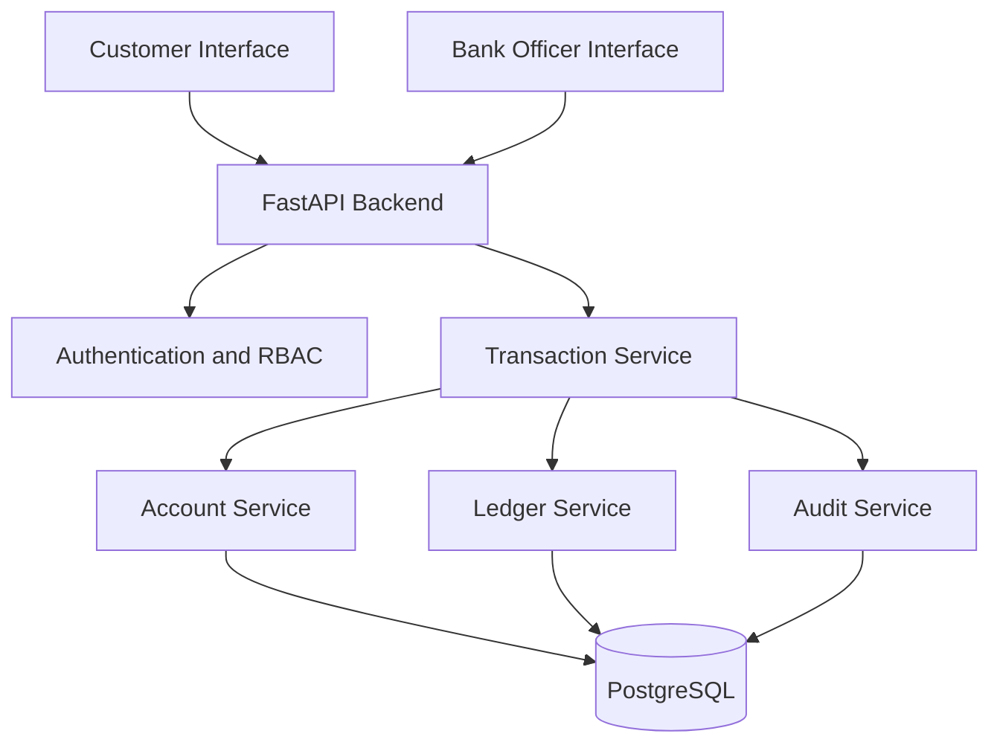

# Core Banking & Ledger Engine

A simulated core banking platform built around double-entry accounting, financial transaction integrity, concurrency control, and auditability.

## Project Overview

The Core Banking & Ledger Engine is a backend-focused banking application designed to demonstrate how financial transactions can be processed reliably using double-entry accounting principles.

Instead of simply updating account balances, every financial operation is recorded through balanced journal entries. The system maintains a traceable financial record and ensures that transactions are processed atomically.

The application will provide separate interfaces for customers and bank officers, supported by a modular backend architecture.

### Project Objectives

- Implement a double-entry accounting system.
- Maintain accurate and consistent account balances.
- Process financial transactions atomically.
- Handle concurrent transactions safely.
- Prevent duplicate operations using idempotency.
- Maintain an append-only audit trail.
- Demonstrate practical backend engineering and database design.

> **Status:** Planning and architecture  
> **Project type:** Educational software engineering project  
> **Scope:** Simulated, single-currency banking environment. Not intended for real financial transactions.

---

## Core Features — V1

### 1. Authentication and Access Control
- User authentication and authorization.
- Role-based access control.
- Customer and bank-officer roles.
- Protected API endpoints.

### 2. Account Management
- Customer account creation and management.
- Savings and current account types.
- Account status management.
- Ledger and available balance tracking.
- Explicit overdraft configuration.

### 3. Financial Transactions
- Deposits.
- Withdrawals.
- Internal account transfers.
- Transaction history.
- Transaction reversals through compensating journal entries.

### 4. Double-Entry Ledger
- Chart of accounts and internal general-ledger accounts.
- Journal entries and journal lines.
- Explicit debit and credit records.
- Validation that every posted journal entry balances.
- Immutable posted financial records.

### 5. Transaction Integrity
- Atomic database transactions.
- PostgreSQL row-level locking.
- Idempotency keys to prevent duplicate requests.
- Deterministic account locking to reduce deadlocks.
- Database-level financial integrity constraints.

### 6. Audit and Monitoring
- Append-only audit records.
- Transaction references and timestamps.
- Officer-level transaction inspection.
- Balance reconciliation against ledger records.

### 7. User Interfaces
- Customer dashboard.
- Account summaries and transaction history.
- Transfer interface.
- Bank-officer dashboard.
- Ledger and audit inspection interface.

---

## Technology Stack

| Layer | Technology | Purpose |
|---|---|---|
| Frontend | Next.js | Web application |
| Language | TypeScript | Frontend development |
| Styling | Tailwind CSS | UI styling |
| Components | shadcn/ui | Interface components |
| Backend | Python | Backend development |
| API Framework | FastAPI | REST API |
| Database | PostgreSQL | Financial data storage |
| ORM | SQLAlchemy 2.0 | Database interaction |
| Migrations | Alembic | Schema versioning |
| Testing | Pytest | Automated testing |
| Containerization | Docker | Application environment |
| Orchestration | Docker Compose | Local development |
| CI/CD | GitHub Actions | Automated testing and integration |
| Version Control | Git and GitHub | Source control |

---

## System Architecture

The application will follow a **modular monolith architecture**.

The frontend and backend will be separate applications. The backend will contain clearly separated business modules, while financial operations will be coordinated through a central transaction service.

### High-Level Architecture

### Backend Modules

| Module | Responsibility |
|---|---|
| Authentication | Login, sessions and authorization |
| Users | User account management |
| Customers | Customer information |
| Accounts | Banking account management |
| Transactions | Financial operation coordination |
| Ledger | Journal entries and accounting rules |
| Audit | Activity records |

### Financial Transaction Flow

Every financial operation will pass through the Transaction Service.

1. Receive and validate the transaction request.
2. Authenticate the user and verify permissions.
3. Check the idempotency key.
4. Lock relevant account records.
5. Validate account status and available funds.
6. Create the transaction and balanced journal entries.
7. Update account balance projections.
8. Record the audit event.
9. Commit the database transaction atomically.
10. Return the transaction result.

If an operation fails, the database transaction must roll back without leaving partial financial records.

---

## Database and Ledger Design

PostgreSQL will serve as the primary system of record.

### Initial Data Entities

- `users`
- `roles`
- `customers`
- `accounts`
- `chart_of_accounts`
- `transactions`
- `journal_entries`
- `journal_lines`
- `idempotency_keys`
- `audit_logs`

### Double-Entry Accounting

Every posted journal entry must contain at least two valid journal lines, with total debits equal to total credits.

**Example: Customer deposit of 100**

| Account | Debit | Credit |
|---|---:|---:|
| System Cash / Vault | 100.00 | 0.00 |
| Customer Deposit Liability | 0.00 | 100.00 |
| **Total** | **100.00** | **100.00** |

Customer deposits are liabilities of the bank, while cash held by the bank is an asset.

### Financial Integrity Principles

- Use fixed-precision `NUMERIC` values for monetary amounts.
- Never use floating-point arithmetic for financial calculations.
- Treat posted journal entries as immutable.
- Use compensating entries for reversals.
- Maintain account balances as controlled projections of ledger activity.
- Reconcile balance projections against ledger records.
- Use database constraints and deferred validation for journal integrity.

---

## Development Roadmap

| Stage | Focus | Deliverables |
|---|---|---|
| 1 | Project Setup | Repository, environment and application structure |
| 2 | Database Design | PostgreSQL schema, relationships and migrations |
| 3 | Ledger Engine | Double-entry posting, deposits, withdrawals and transfers |
| 4 | Transaction Integrity | Locking, idempotency, reversals and concurrency tests |
| 5 | Authentication and API | User authentication, RBAC and REST endpoints |
| 6 | Frontend Development | Customer and bank-officer dashboards |
| 7 | Testing and Deployment | Integration tests, Docker, CI/CD and documentation |

Each stage will be implemented and tested before proceeding to the next. Financial correctness and data integrity will take priority over adding features quickly.

---

## Testing Strategy

The project will use automated unit and integration testing.

Important test scenarios include:

- Successful deposits and withdrawals.
- Successful internal transfers.
- Insufficient-funds handling.
- Reversal of posted transactions.
- Duplicate requests with identical idempotency keys.
- Reuse of idempotency keys with different payloads.
- Concurrent transfers and withdrawals.
- Database rollback after an injected failure.
- Prevention of unauthorized account access.
- Validation of balanced journal entries.
- Prevention of modifications to posted financial records.
- Reconciliation of account balances against ledger entries.

Concurrency and database integrity tests will run against PostgreSQL rather than relying exclusively on mocked database operations.

---

## Future Enhancements

The following features are outside the initial V1 scope:

- Multi-currency support.
- Loan management and repayment schedules.
- KYC and document verification.
- Advanced fraud detection.
- Transaction holds and settlement workflows.
- Notifications and reporting.
- External financial system integrations.

These enhancements may be considered after the core ledger engine is complete.

---

## Engineering Priorities

1. **Correctness** — Every financial operation must preserve accounting integrity.
2. **Consistency** — Account balances and ledger records must remain synchronized.
3. **Reliability** — Failed operations must not leave partial updates.
4. **Security** — Authentication, authorization and sensitive-data protection.
5. **Auditability** — Financial activities must be traceable.
6. **Maintainability** — Modular code, migrations, documentation and automated tests.

---

## Project Goals

The ultimate goal is to develop a working, well-documented banking simulation demonstrating practical knowledge of:

- Backend engineering and REST API development.
- Relational database design and transaction management.
- Double-entry accounting and financial data modelling.
- Concurrency control and idempotent operations.
- Software testing and database integrity.
- Containerization and CI/CD practices.

> A banking system should not simply calculate balances. It should maintain a reliable, traceable record of how every balance was created.
