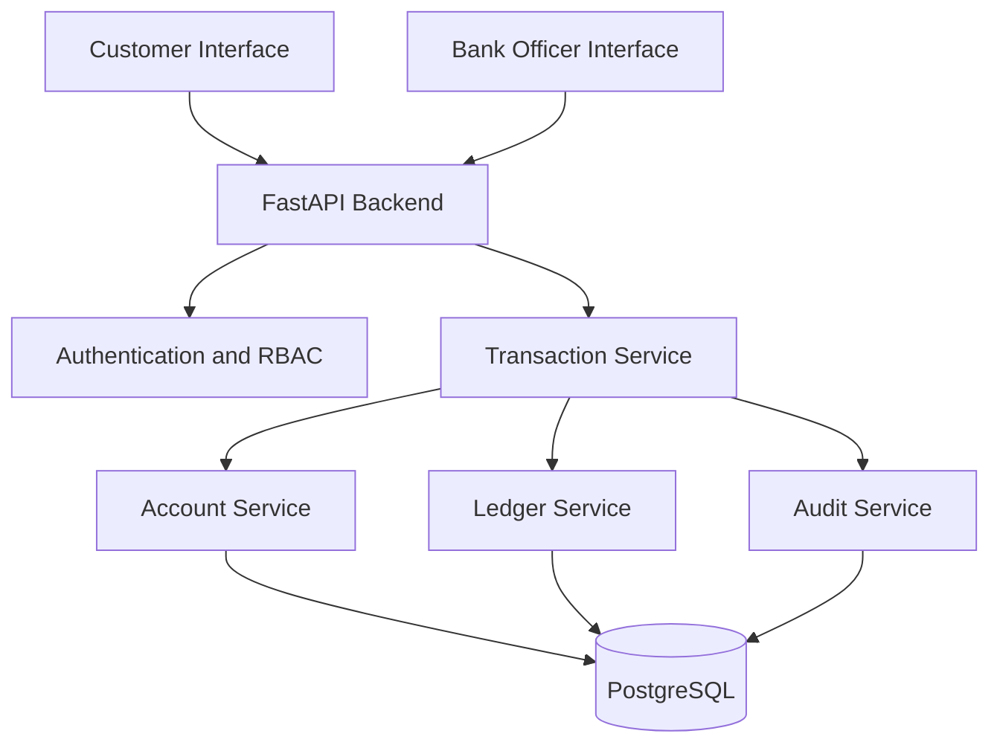

# System Architecture

## 1. Architectural Approach

The Core Banking & Ledger Engine will use a modular monolith architecture.

The frontend and backend will operate as separate applications. The backend will contain independent business modules within a single FastAPI application and share one PostgreSQL database.

This approach keeps the application maintainable without introducing unnecessary distributed-system complexity.

## 2. High-Level Architecture

## 3. Application Layers

### Frontend Layer

Technology:
- Next.js
- TypeScript
- Tailwind CSS
- shadcn/ui

Responsibilities:
- Customer dashboard.
- Account summaries.
- Transaction history.
- Transfer interface.
- Bank-officer dashboard.
- Ledger inspection interface.

The frontend communicates with the backend through REST APIs. It does not directly access the database or implement financial posting logic.

### API Layer

Technology:
- Python
- FastAPI

Responsibilities:
- Expose REST endpoints.
- Validate incoming requests.
- Authenticate users.
- Enforce role-based authorization.
- Coordinate requests with business services.
- Return consistent API responses.

### Business Logic Layer

The backend will be organized into the following modules.

| Module | Responsibility |
|---|---|
| Authentication | Login, sessions and authorization |
| Users | User account management |
| Customers | Customer information |
| Accounts | Banking account management |
| Transactions | Financial operation coordination |
| Ledger | Journal entries and accounting rules |
| Audit | Activity records |

### Data Layer

Technology:
- PostgreSQL
- SQLAlchemy 2.0
- Alembic

Responsibilities:
- Persist application records.
- Enforce relational integrity.
- Manage database transactions.
- Maintain financial records.
- Support migrations and schema versioning.

## 4. Transaction Processing Architecture

All financial operations must pass through the Transaction Service.

The Transaction Service coordinates the Account, Ledger and Audit services within one database transaction.

### Transaction Lifecycle

1. Receive a financial operation request.
2. Authenticate the user and verify permissions.
3. Validate the request and idempotency key.
4. Lock the affected account records.
5. Validate account status and available funds.
6. Create the transaction record.
7. Generate balanced journal entries.
8. Update account balance projections.
9. Record the audit event.
10. Commit all changes atomically.

If any operation fails, the database transaction must roll back.

## 5. Double-Entry Ledger Architecture

The ledger is the financial system of record.

Every posted journal entry must contain at least two valid journal lines.

The sum of debit amounts must equal the sum of credit amounts.

### Example: Customer Deposit

For a deposit of 100:

| Account | Debit | Credit |
|---|---:|---:|
| System Cash / Vault | 100.00 | 0.00 |
| Customer Deposit Liability | 0.00 | 100.00 |

The system cash account represents a bank asset. Customer deposits represent liabilities owed by the bank.

### Account Balance Management

The ledger is the source of truth.

The account table will maintain controlled balance projections:
- Ledger balance.
- Available balance.

These projections will be updated atomically with successful ledger postings and periodically reconciled against journal activity.

## 6. Concurrency and Idempotency

### Row-Level Locking

PostgreSQL row-level locking using `SELECT ... FOR UPDATE` will protect account records during financial operations.

When multiple accounts are involved, account rows will be locked in a deterministic order to reduce deadlock risk.

Suitable deadlocks may be handled through bounded retries of the complete transaction.

### Idempotency

Each financial request will include an idempotency key.

The database will enforce uniqueness within the defined user and operation scope.

If the same request is submitted again with the same payload, the original result will be returned.

If the same key is reused with a different payload, the API will return a conflict response.

The idempotency record, financial posting and resulting response will be persisted atomically.

## 7. Audit Architecture

Every relevant financial operation will generate an audit record.

Audit records will capture:
- Actor.
- Action.
- Resource.
- Timestamp.
- Transaction reference.
- Request correlation reference where applicable.

Audit records will be append-only from the application's perspective.

Passwords, authentication tokens and other sensitive secrets must never be written to audit logs.

## 8. Security Principles

- Passwords will be hashed using Argon2id.
- Backend endpoints will enforce authentication and authorization.
- Customers may only access their authorized accounts.
- Bank-officer permissions will be restricted by role.
- Secrets will be stored in environment variables.
- Database access will follow least-privilege principles.
- Financial records will not be exposed through unrestricted API responses.

## 9. Architectural Decisions

| Decision | Choice | Reason |
|---|---|---|
| Backend architecture | Modular monolith | Simplicity and maintainability |
| API framework | FastAPI | Python-based REST API |
| Database | PostgreSQL | ACID transactions and row locking |
| ORM | SQLAlchemy 2.0 | Structured database access |
| Migrations | Alembic | Controlled schema evolution |
| Financial model | Double-entry ledger | Traceable accounting |
| Concurrency | Row-level locking | Protect concurrent financial operations |
| Duplicate protection | Idempotency keys | Prevent duplicate postings |
| Monetary representation | Fixed-precision NUMERIC | Avoid floating-point errors |

## 10. Architecture Scope

The initial version will not use:
- Microservices.
- Redis.
- Celery.
- Kubernetes.
- Multi-currency processing.
- External payment integrations.

These technologies and capabilities may be evaluated in future versions if justified by actual requirements.

