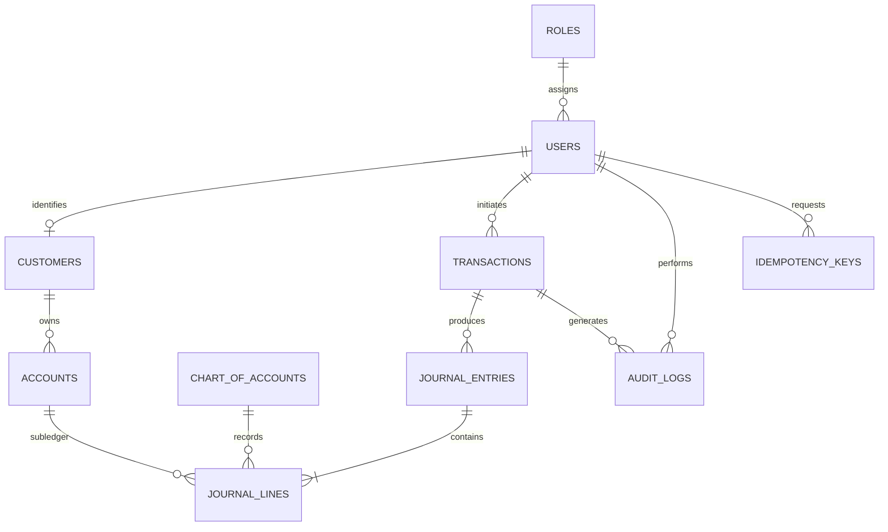

# Database Design — Core Banking & Ledger Engine

## 1. Overview

PostgreSQL will serve as the primary system of record for the application.

The database is designed around double-entry accounting. Customer-facing account balances are maintained as controlled projections, while posted journal entries provide the authoritative financial record.

The initial implementation will support a single configured currency.

### Design Objectives

- Maintain accurate financial records.
- Enforce double-entry accounting principles.
- Preserve transaction history.
- Prevent duplicate financial operations.
- Support concurrent financial transactions.
- Maintain referential and transactional integrity.
- Provide an auditable record of financial activity.

---

## 2. Database Technology

| Component | Technology |
|---|---|
| Database | PostgreSQL |
| ORM | SQLAlchemy 2.0 |
| Migrations | Alembic |
| Data validation | Pydantic |
| Testing | Pytest |

Monetary values will use PostgreSQL `NUMERIC` columns with an explicitly defined precision and scale. Floating-point types will not be used for financial calculations.

---

## 3. Core Database Entities

The initial schema will contain the following entities:

| Table | Purpose |
|---|---|
| `users` | Authentication and user identity |
| `roles` | Application access roles |
| `customers` | Customer profile information |
| `accounts` | Customer-facing banking accounts |
| `chart_of_accounts` | Bank general-ledger accounts |
| `transactions` | Business transaction records |
| `journal_entries` | Accounting journal headers |
| `journal_lines` | Individual debit and credit records |
| `idempotency_keys` | Duplicate-request protection |
| `audit_logs` | Append-only activity records |

---

## 4. Entity Design

### 4.1 Users

Stores application identities and authentication information.

Proposed fields:

| Field | Type | Description |
|---|---|---|
| `id` | UUID | Primary key |
| `email` | VARCHAR | Unique login identifier |
| `password_hash` | VARCHAR | Argon2id password hash |
| `role_id` | UUID | Foreign key to roles |
| `is_active` | BOOLEAN | Account access status |
| `created_at` | TIMESTAMPTZ | Creation timestamp |
| `updated_at` | TIMESTAMPTZ | Last update timestamp |

Passwords must never be stored in plaintext.

### 4.2 Roles

Defines the application's access roles.

Initial roles:

- CUSTOMER
- BANK_OFFICER

Role-based authorization will be enforced by the backend, not merely by hiding frontend features.

### 4.3 Customers

Stores customer profile information separately from authentication credentials.

| Field | Type | Description |
|---|---|---|
| `id` | UUID | Primary key |
| `user_id` | UUID | Associated user |
| `full_name` | VARCHAR | Customer name |
| `phone` | VARCHAR | Contact number |
| `address` | TEXT | Address |
| `created_at` | TIMESTAMPTZ | Creation timestamp |

A customer may own multiple banking accounts.

### 4.4 Accounts

Represents customer-facing banking accounts.

| Field | Type | Description |
|---|---|---|
| `id` | UUID | Primary key |
| `customer_id` | UUID | Account owner |
| `account_number` | VARCHAR | Unique account identifier |
| `account_type` | VARCHAR | SAVINGS or CURRENT |
| `status` | VARCHAR | Account status |
| `currency` | CHAR(3) | Configured currency |
| `ledger_balance` | NUMERIC(19,4) | Posted balance projection |
| `available_balance` | NUMERIC(19,4) | Spendable balance projection |
| `allow_overdraft` | BOOLEAN | Whether negative available balance is permitted |
| `created_at` | TIMESTAMPTZ | Creation timestamp |
| `updated_at` | TIMESTAMPTZ | Last update timestamp |

Important rules:

- Every account belongs to a customer.
- Account numbers must be unique.
- Account status must be validated before posting.
- Balance projections must be updated atomically with ledger postings.
- Reconciliation must be able to recompute balances from ledger records.
- V1 will not implement transaction holds, so available and ledger balances will normally coincide.

An overdraft-aware database constraint will be applied:

```sql
CHECK (
    allow_overdraft = TRUE
    OR available_balance >= 0
)
```

### 4.5 Chart of Accounts

Represents the bank's internal general-ledger accounts.

Examples:

| Code | Account | Category |
|---|---|---|
| 1000 | System Cash / Vault | ASSET |
| 2000 | Customer Deposits Control | LIABILITY |

The chart of accounts is separate from customer-facing banking accounts.

A customer account is not itself a general-ledger account. Instead, it is represented in the customer deposit liability subledger.

This distinction allows multiple customer accounts to map to the same general-ledger control account while retaining individual customer balances.

Proposed fields:

| Field | Type | Description |
|---|---|---|
| `id` | UUID | Primary key |
| `code` | VARCHAR | Unique account code |
| `name` | VARCHAR | Account name |
| `category` | VARCHAR | ASSET, LIABILITY, EQUITY, REVENUE or EXPENSE |
| `is_active` | BOOLEAN | Account status |
| `created_at` | TIMESTAMPTZ | Creation timestamp |

### 4.6 Transactions

Represents the business-level financial operation.

Examples:

- DEPOSIT
- WITHDRAWAL
- TRANSFER
- REVERSAL

Proposed fields:

| Field | Type | Description |
|---|---|---|
| `id` | UUID | Primary key |
| `reference` | VARCHAR | Unique transaction reference |
| `transaction_type` | VARCHAR | Operation type |
| `status` | VARCHAR | Transaction status |
| `amount` | NUMERIC(19,4) | Requested amount |
| `currency` | CHAR(3) | Transaction currency |
| `initiated_by` | UUID | User who initiated the operation |
| `reverses_transaction_id` | UUID | Original transaction, if this is a reversal |
| `created_at` | TIMESTAMPTZ | Creation timestamp |
| `posted_at` | TIMESTAMPTZ | Posting timestamp |

Initial transaction lifecycle:

```text
INITIATED
    |
    v
POSTED
    |
    v
REVERSED
```

Failed operations must not leave partially posted financial records.

A posted transaction must not be edited or deleted. Reversals must use compensating accounting entries.

A transaction may be reversed at most once.

### 4.7 Journal Entries

Represents the accounting header associated with a financial operation.

Proposed fields:

| Field | Type | Description |
|---|---|---|
| `id` | UUID | Primary key |
| `transaction_id` | UUID | Associated transaction |
| `status` | VARCHAR | DRAFT or POSTED |
| `description` | TEXT | Accounting description |
| `created_at` | TIMESTAMPTZ | Creation timestamp |
| `posted_at` | TIMESTAMPTZ | Posting timestamp |

Each posted journal entry must contain at least two valid journal lines.

### 4.8 Journal Lines

Stores individual debit and credit movements.

Proposed fields:

| Field | Type | Description |
|---|---|---|
| `id` | UUID | Primary key |
| `journal_entry_id` | UUID | Parent journal entry |
| `gl_account_id` | UUID | General-ledger account |
| `customer_account_id` | UUID | Optional customer subledger account |
| `debit_amount` | NUMERIC(19,4) | Debit value |
| `credit_amount` | NUMERIC(19,4) | Credit value |
| `created_at` | TIMESTAMPTZ | Creation timestamp |

Exactly one of debit or credit must be positive on each journal line.

Proposed database constraint:

```sql
CHECK (
    (debit_amount > 0 AND credit_amount = 0)
    OR
    (credit_amount > 0 AND debit_amount = 0)
)
```

Additional rules:

- Amounts cannot be negative.
- Every journal line must reference a valid GL account.
- Customer subledger references must be valid where required.
- Posted journal lines must not be modified or deleted.
- Every posted journal entry must balance.

A normal row-level CHECK constraint cannot validate the sum of multiple journal lines. Aggregate journal validation will therefore require deferred database validation and application-level checks.

The final implementation will also protect against modifying or deleting posted entries and against posting entries with fewer than two lines.

---

## 5. Financial Accounting Examples

The system will use the following accounting treatment.

### 5.1 Deposit

A customer deposits 100 into their account.

| Account | Debit | Credit |
|---|---:|---:|
| System Cash / Vault | 100.00 | 0.00 |
| Customer Deposit Liability | 0.00 | 100.00 |
| Total | 100.00 | 100.00 |

The bank's cash asset increases and its liability to the customer increases.

The customer account is identified on the customer deposit liability journal line.

### 5.2 Withdrawal

A customer withdraws 40.

| Account | Debit | Credit |
|---|---:|---:|
| Customer Deposit Liability | 40.00 | 0.00 |
| System Cash / Vault | 0.00 | 40.00 |
| Total | 40.00 | 40.00 |

The bank's liability to the customer decreases and its cash asset decreases.

### 5.3 Internal Transfer

Customer A transfers 30 to Customer B.

| Account | Debit | Credit |
|---|---:|---:|
| Customer A Deposit Liability | 30.00 | 0.00 |
| Customer B Deposit Liability | 0.00 | 30.00 |
| Total | 30.00 | 30.00 |

Both lines use the customer deposit liability control account in the general ledger, but reference different customer subledger accounts.

The bank's total deposit liability remains unchanged.

### 5.4 Reversal

A posted transaction must never be deleted to correct an error.

A reversal creates a new transaction and compensating journal entry with the opposite accounting effect.

The reversal must reference the original transaction and the database must prevent multiple reversals of the same original transaction.

---

## 6. Idempotency Design

The `idempotency_keys` table protects against duplicate financial requests.

Proposed fields:

| Field | Type | Description |
|---|---|---|
| `id` | UUID | Primary key |
| `user_id` | UUID | Requesting user |
| `operation` | VARCHAR | Operation scope |
| `key` | VARCHAR | Client-provided key |
| `request_hash` | VARCHAR | Canonical request payload hash |
| `transaction_id` | UUID | Resulting transaction |
| `response_payload` | JSONB | Stored original response |
| `created_at` | TIMESTAMPTZ | Creation timestamp |

A unique constraint will cover:

```text
(user_id, operation, key)
```

### Request Handling

1. Receive the idempotency key.
2. Calculate a canonical request payload hash.
3. Attempt to create the idempotency record within the same database transaction as the financial operation.
4. If the key already exists, roll back the failed transaction.
5. Read the existing record in a fresh database transaction.
6. Compare the stored request hash with the new request hash.
7. Return the original response when the payload matches.
8. Return HTTP 409 Conflict when the same key is reused with a different payload.

The idempotency record, journal posting, balance updates and audit record must commit or roll back together.

---

## 7. Audit Logs

The `audit_logs` table stores important application and financial activity.

Proposed fields:

| Field | Type | Description |
|---|---|---|
| `id` | UUID | Primary key |
| `actor_id` | UUID | User performing the action |
| `action` | VARCHAR | Activity type |
| `resource_type` | VARCHAR | Affected resource |
| `resource_id` | UUID | Resource identifier |
| `transaction_id` | UUID | Related financial transaction |
| `request_id` | VARCHAR | Request correlation reference |
| `details` | JSONB | Non-sensitive event details |
| `created_at` | TIMESTAMPTZ | Event timestamp |

Audit records will be append-only from the application's perspective.

The application database role will not have permission to update or delete audit records.

Audit records will not contain passwords, tokens or other authentication secrets.

Financial audit records will be created in the same database transaction as the operation they describe.

---

## 8. Relationships

The main relationships are:



The final SQLAlchemy models and Alembic migrations will define the precise foreign keys, deletion behavior, indexes and uniqueness constraints.

---

## 9. Database Integrity Rules

The following rules will be enforced through appropriate database constraints, transactional application logic and restricted database permissions.

### Financial Rules

- Monetary amounts must be positive.
- Monetary values must use fixed precision.
- Each journal line must contain exactly one positive debit or credit.
- Every posted journal entry must balance.
- Every posted journal entry must contain at least two lines.
- Customer accounts must not be overdrawn unless overdrafts are explicitly permitted.
- Account and transaction currencies must match the configured V1 currency.

### Transaction Rules

- Financial operations must execute inside database transactions.
- Account records must be locked before balance-sensitive operations.
- Account rows must be locked in deterministic order.
- Duplicate requests must be protected by database uniqueness constraints.
- A posted transaction must not be deleted or overwritten.
- Reversals must create compensating journal entries.
- A transaction may be reversed only once.

### Audit Rules

- Audit records must be append-only.
- Financial postings and their audit events must commit atomically.
- Application roles must not have unrestricted access to sensitive records.

---

## 10. Indexing Strategy

Indexes will be added to frequently queried and constrained columns.

Initial candidates:

- `users.email` — unique index.
- `accounts.account_number` — unique index.
- `accounts.customer_id` — customer account lookup.
- `transactions.reference` — unique index.
- `transactions.created_at` — transaction history.
- `journal_entries.transaction_id` — transaction lookup.
- `journal_lines.journal_entry_id` — journal lookup.
- `journal_lines.gl_account_id` — GL account reporting.
- `journal_lines.customer_account_id` — customer subledger lookup.
- `idempotency_keys(user_id, operation, key)` — unique index.
- `audit_logs.created_at` — audit history.

Indexes will be reviewed against actual query patterns during implementation.

---

## 11. Balance Reconciliation

The ledger is the authoritative financial record.

The system will provide a reconciliation process that:

1. Retrieves posted journal lines for an account.
2. Calculates the account's balance according to its accounting classification and normal balance.
3. Compares the calculated amount with the stored balance projection.
4. Identifies discrepancies.
5. Reports discrepancies without silently modifying posted financial records.

Balance projections will be updated atomically during successful postings.

---

## 12. Deferred Database Validation

PostgreSQL deferred constraint triggers will be considered for aggregate journal validation.

The validation design must cover:

- Journal entry status transitions to POSTED.
- Journal line insertion.
- Journal line updates and deletion.
- Entries with no journal lines.
- Entries containing fewer than two lines.
- Debit and credit totals.
- Attempts to modify already posted entries.

A trigger only on journal-line insertion is insufficient.

The final implementation will test deferred validation against PostgreSQL at transaction commit time.

Application-level validation will also check journal balance before posting. Database-level validation provides an additional integrity boundary.

---

## 13. Scope and Implementation Notes

This document defines the proposed V1 logical database design.

It is not yet the final migration schema. Exact column definitions, constraints, indexes, foreign keys, trigger implementations and deletion policies will be finalized during database implementation.

The initial version will not include:

- Multi-currency accounting.
- Loan origination and EMI schedules.
- KYC document storage.
- Transaction holds.
- Multi-branch banking.
- External payment integrations.
- Distributed database architecture.

The priority is to implement a correct and testable single-currency double-entry ledger before introducing additional banking features.

